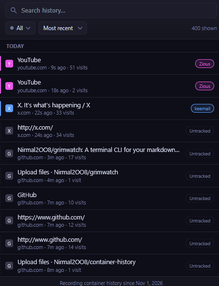
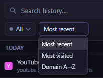

# Container History

A Firefox extension that remembers which [Multi-Account Container](https://addons.mozilla.org/firefox/addon/multi-account-containers/) each URL was visited in, and lets you browse, search and filter your history by container — so you never lose track of which identity a page belongs to.


## Screenshots





## Features

- Records the container (cookie store) each visited URL was opened in
- Browse and search full history, filtered by container
- Sort by most recent, most visited, or domain A→Z
- Reopen a history entry in its original container with one click
- Keyboard shortcut: `Ctrl+Shift+H` (`MacCtrl+Shift+H` on macOS) opens the popup
- Right-click context menu integration
- All data stored locally — nothing leaves your machine (see [PRIVACY.md](PRIVACY.md))

## Installation

### From addons.mozilla.org (recommended)
Once published: [link to be added after the AMO listing goes live].

### Manual / development install
1. Open `about:debugging#/runtime/this-firefox` in Firefox.
2. Click **Load Temporary Add-on…**.
3. Select `manifest.json` from this repository.

This loads the extension until you restart Firefox. For a permanent local install without AMO review, see [Publishing](#publishing-to-addonsmozillaorg-amo) below (self-distribution / unlisted signing).

## Requirements

- Firefox 140.0 or later (set by `strict_min_version` in `manifest.json`; required for the `data_collection_permissions` manifest key AMO now mandates)
- The [Multi-Account Containers](https://addons.mozilla.org/firefox/addon/multi-account-containers/) add-on is recommended (not required) to get the most out of this extension, since it's what creates named containers to begin with.

## Permissions

| Permission | Why it's needed |
|---|---|
| `history` | Read and query your browsing history to build the container map |
| `tabs` | Reopen URLs in the correct container tab |
| `contextualIdentities` | Read container (contextual identity) names, colors and icons |
| `cookies` | Determine which cookie store (container) a page belongs to |
| `storage` | Persist the url→container map locally via `browser.storage.local` |
| `contextMenus` | Add the right-click "open in container" entry |

## Development

No build step — this is a plain MV2 extension (`background.js`, `popup.html/js/css`). To work on it:

```bash
# Lint against Firefox's add-on policies before every submission
npx web-ext lint

# Run in a disposable Firefox profile with live reload
npx web-ext run
```

## Project structure

```
manifest.json      Extension manifest (MV2, Gecko-targeted)
background.js       Persistent background script: records history → container mappings
popup.html/js/css   Toolbar popup UI: search, filter, sort, reopen
icons/              Toolbar and store icons (16/48/128px)
```

## Contributing

See [CONTRIBUTING.md](CONTRIBUTING.md).

## License

[MIT](LICENSE)

## Publishing to addons.mozilla.org (AMO)

See [PUBLISHING.md](PUBLISHING.md) for the full step-by-step release process.
